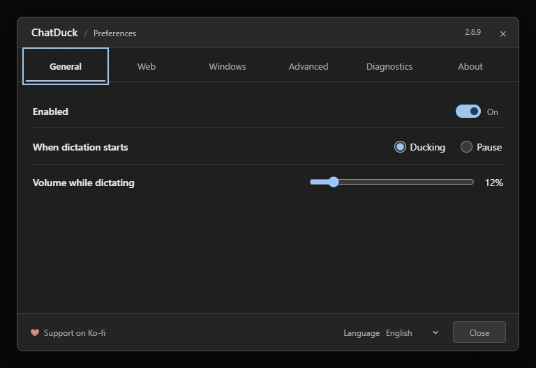
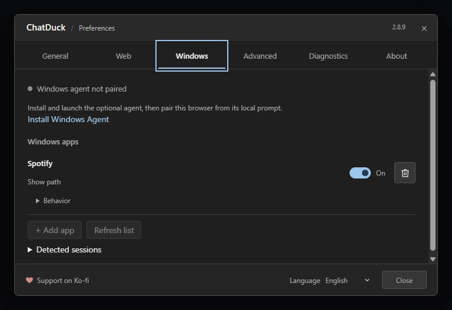

  
  <h1>ChatDuck</h1>
  
<strong>Mantén el audio bajo control mientras dictas a ChatGPT.</strong>

  
<a href="https://github.com/fevegit/chatduck/releases/latest">v2.8.9</a> · <a href="LICENSE">Licencia MIT</a> · Navegador + agente Windows opcional

  
<a href="README.md">English</a>

Ilustración promocional; el panel que aparece es una maqueta, no una captura del programa.

  
  

  

## Qué hace

ChatDuck coordina la reproducción multimedia compatible con el dictado de voz de ChatGPT. El **Modo navegador** funciona por sí solo; el **Agente opcional de Windows** añade controles para aplicaciones de escritorio seleccionadas.

## La interfaz

Capturas nuevas del tema oscuro de la interfaz real del userscript 2.8.9, renderizadas en Chromium aislado ejecutando el paquete exacto de la release. La pestaña Windows usa una aplicación de demostración; la vista previa no está emparejada con ningún agente ni contiene datos personales. La ilustración promocional anterior es distinta de estas capturas del producto.

## Modo navegador

El userscript controla audio y vídeo HTML5 compatibles del navegador. Elige **Pausar** o **Ducking**, ajusta el volumen atenuado y configura reglas o exclusiones por sitio. Cada frame gestiona su propio documento. ChatGPT y los sitios de comunicación se excluyen del control multimedia de forma predeterminada.

No intercepta Web Audio ni modifica APIs de la página. No controla Shadow DOM cerrado, reproductores personalizados que no exponen medios HTML controlables ni reproducción exclusiva de Web Audio. La alternativa opcional de silenciar pestaña silencia la pestaña entera, no un elemento multimedia concreto.

## Agente opcional de Windows

El agente añade controles por aplicación para sesiones multimedia compatibles de Windows, incluidos reproductores como Spotify y Plex. Selecciona aplicaciones detectadas o añade un ejecutable; después elige Pausar o Ducking y configura el volumen. Pausar depende de que la aplicación admita controles multimedia; Ducking requiere una sesión de audio accesible. El agente no controla funciones arbitrarias ni el volumen maestro de Windows.

Se ejecuta como el usuario conectado y se comunica con el userscript mediante loopback tras emparejarse. El MSI x64 requiere Windows 10 versión 1809 o posterior y **.NET 10 Desktop Runtime (x64)**. El MSI **no está firmado**. La instalación y actualización se verificaron en el equipo Windows del responsable; la compatibilidad no se ha probado exhaustivamente en otros equipos o hardware.

## Instalación y configuración

1. Instala [Tampermonkey](https://www.tampermonkey.net/) en un navegador de escritorio compatible.
2. Pulsa **Instalar userscript** y confirma el aviso de Tampermonkey.
3. Abre **ChatGPT Audio Ducking → Open ChatDuck settings** desde Tampermonkey.
4. Instala el agente opcional solo si necesitas controlar aplicaciones de escritorio; ejecútalo y sigue las instrucciones de emparejamiento.

Se conservan el nombre y el namespace originales del userscript para que Tampermonkey actualice las instalaciones existentes en el sitio. Tampermonkey guarda las preferencias; el emparejamiento y los ajustes del agente se guardan para el usuario actual de Windows.

## Privacidad, seguridad y desinstalación

ChatDuck no incluye analítica, telemetría, cuentas ni funciones de pago. El userscript no solicita acceso al micrófono ni a la cámara. El agente opcional solo escucha en `127.0.0.1`, autentica las órdenes con HMAC tras el emparejamiento y no captura audio del micrófono. Consulta [Privacidad](docs/PRIVACY.md), [Permisos](docs/PERMISSIONS.md) y [Seguridad](docs/SECURITY.md).

Elimina **ChatGPT Audio Ducking** desde el panel de Tampermonkey. Desinstala **ChatDuck Windows Agent** por separado desde Configuración de Windows → Aplicaciones. Consulta la [guía de desinstalación](docs/UNINSTALL.md).

## Código fuente

Este repositorio incluye el código, las pruebas de regresión y los pasos para reproducir la compilación. Consulta [Desarrollo](docs/DEVELOPMENT.md). Las descargas incluyen un manifiesto SHA-256. ChatDuck es gratuito y de código abierto bajo la [licencia MIT](LICENSE); las donaciones en Ko-fi son voluntarias y no desbloquean funciones.
