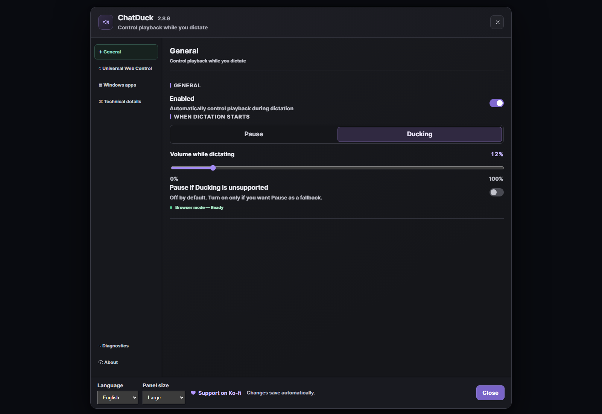
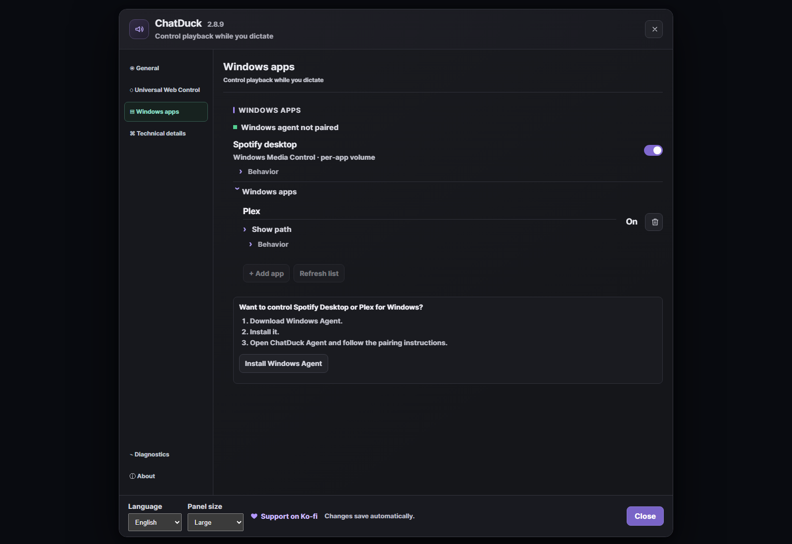

  
  <h1>ChatDuck</h1>
  
<strong>Mantén el audio bajo control mientras dictas a ChatGPT.</strong>

  

    
    
    
    
  

  
<a href="README.md">Read in English</a> · <a href="https://ko-fi.com/fevee">Apoya en Ko-fi</a>

---

## Instalar

  
  &nbsp;
  

1. Instala [Tampermonkey](https://www.tampermonkey.net/) en un navegador de escritorio compatible.
2. Abre **Instalar userscript** y confirma la instalación en Tampermonkey.
3. Abre ChatDuck desde el menú de Tampermonkey para configurar la reproducción.

Se conservan deliberadamente el nombre y el espacio de nombres originales del userscript para que Tampermonkey actualice la instalación existente en vez de crear otra.

## Qué hace

ChatDuck coordina la reproducción de medios compatibles con el dictado de voz de ChatGPT. El Modo navegador funciona por sí solo. El Agente opcional de Windows añade controles para aplicaciones multimedia de escritorio seleccionadas.

Captura del preview local aislado con el código Native de ajustes 2.8.9; no procede de una sesión de usuario.

### Modo navegador

El userscript controla audio y vídeo HTML5 compatibles del navegador, incluidos sitios que añadas o mantengas habilitados para el control universal. Elige **Pausar** o **Ducking**, ajusta el volumen atenuado y configura reglas o exclusiones por sitio desde el panel de ajustes Native. Cada frame gestiona su propio documento. ChatGPT y los sitios de comunicación se excluyen del control multimedia de forma predeterminada.

No intercepta Web Audio ni modifica APIs de la página. No controla Shadow DOM cerrado, reproductores que no exponen medios HTML controlables ni reproducción exclusiva de Web Audio. La alternativa opcional de silenciar pestaña de Tampermonkey silencia la pestaña entera y es independiente de la atenuación por medio.

### Agente opcional de Windows

El preview utiliza datos de demostración y muestra el agente Windows sin emparejar.

El agente añade controles por aplicación para sesiones multimedia compatibles de Windows, incluidos reproductores de escritorio como Spotify y Plex. Selecciona aplicaciones detectadas o añade un ejecutable; después elige Pausar o Ducking y configura el volumen. Pausar depende de que la aplicación admita controles multimedia; Ducking requiere una sesión de audio accesible. El agente no controla funciones arbitrarias de las aplicaciones ni el volumen maestro de Windows.

El agente es opcional y se ejecuta como el usuario conectado. Se comunica con el userscript mediante loopback y se empareja con un secreto propio de la instalación. Instala el MSI x64 solo si necesitas controlar aplicaciones de escritorio. Requiere Windows 10 versión 1809 o posterior y **.NET 10 Desktop Runtime (x64)**. El MSI **no está firmado actualmente**. La instalación y actualización se verificaron en el equipo Windows del responsable; esto no equivale a pruebas exhaustivas en otros equipos o hardware.

## Compatibilidad y requisitos

- Navegador de escritorio compatible con Tampermonkey, como Chrome, Edge o Firefox.
- Entrada de voz de ChatGPT para coordinar la reproducción con el dictado.
- Opcional: Windows 10 versión 1809 o posterior x64 y .NET 10 Desktop Runtime x64 para el agente.
- Una sesión multimedia compatible para controlar aplicaciones de escritorio.

El userscript no solicita acceso al micrófono ni a la cámara. ChatGPT gestiona la entrada de voz.

## Configuración

Abre **Tampermonkey → ChatGPT Audio Ducking → Open ChatDuck settings**. Elige el modo general y el volumen; después configura reglas por sitio, exclusiones, comportamiento del navegador y, si está emparejado, las aplicaciones Windows seleccionadas. Tampermonkey guarda las preferencias localmente; el emparejamiento y los ajustes del agente se guardan para el usuario actual de Windows.

## Privacidad y seguridad

ChatDuck funciona localmente: no incluye analítica, telemetría, cuenta ni funciones de pago. El userscript controla medios de la página desde su contexto aislado. El agente opcional solo escucha en `127.0.0.1`, usa órdenes autenticadas con HMAC tras el emparejamiento y no captura audio del micrófono. Consulta [Privacidad](docs/PRIVACY.md), [Permisos](docs/PERMISSIONS.md) y [Seguridad](docs/SECURITY.md).

## Desinstalación

- **Navegador:** elimina **ChatGPT Audio Ducking** desde el panel de Tampermonkey.
- **Agente Windows:** desinstala **ChatDuck Windows Agent** desde Configuración de Windows → Aplicaciones.

Consulta la [guía completa](docs/UNINSTALL.md).

## Compilar desde el código fuente

El repositorio incluye el código, las pruebas de regresión y los pasos de compilación. Consulta [Desarrollo](docs/DEVELOPMENT.md). Las descargas de cada release incluyen un manifiesto SHA-256.

## Apoyo

ChatDuck es gratuito y de código abierto bajo la [licencia MIT](LICENSE). Las donaciones son voluntarias y no desbloquean funciones.

