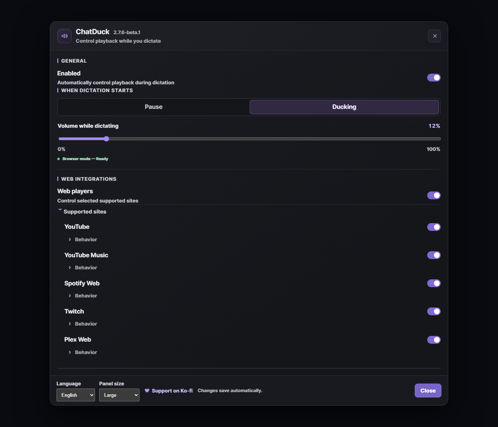

# ChatDuck

**Control web playback while you dictate to ChatGPT.**

> **Experimental branch — v2.8.4-alpha.1.** Not released. The userscript permission scope and universal media engine have changed. An off-by-default Windows option can mute Discord's microphone during dictation; minimized-window behavior still needs isolated validation.

[**Install ChatDuck (userscript)**](https://raw.githubusercontent.com/fevegit/chatduck/main/ChatGPT-Audio-Ducking.user.js) · [Español](README.es.md) · [Report a bug](https://github.com/fevegit/chatduck/issues)

## Get started — 2 steps

1. Install [Tampermonkey](https://www.tampermonkey.net/) for Firefox, Chrome or Edge (skip this if you already have it).
2. [Install ChatDuck](https://raw.githubusercontent.com/fevegit/chatduck/main/ChatGPT-Audio-Ducking.user.js) and approve it in Tampermonkey.

Browser Mode works without a Windows app, token, microphone permission, or pairing. A clean installation defaults to Ducking, and Universal Web Control manages compatible HTML5 audio and video on HTTP and HTTPS pages in the same browser. Existing saved modes remain unchanged. It excludes ChatGPT and communication sites by default. Pause or Ducking and volume are global, with per-site overrides and domain exclusions.

Open settings from **Tampermonkey → ChatGPT Audio Ducking → Open ChatDuck settings**. The legacy userscript name and namespace are intentionally retained so existing installs can update in place instead of creating a duplicate. Your saved preferences are stored by Tampermonkey.

## Browser Mode

The userscript controls standard HTML5 media directly. No Windows agent is needed for:

| Player | Browser Mode |
| --- | --- |
| Known or unknown websites | Controlled when media exposes a writable HTMLMediaElement and the domain is not excluded |
| Same-origin and cross-origin frames | Each frame runs its own isolated controller |
| Open Shadow DOM | Scanned at startup and when its host is added |

Closed shadow roots and custom players that do not expose controllable HTML media remain unsupported. An opt-in Tampermonkey tab-mute fallback can handle a Web Audio-only page, but it mutes the whole tab instead of ducking and remains unverified in LibreWolf. No Web Audio interception or page API patching is used. Real streaming playback still needs manual verification.

Known external issue: [Brave/Chromium and ChromeWideEchoCancellation](docs/known-issues/chromium-wide-echo-cancellation.md). ChatDuck does not change this browser feature automatically.

## Optional Windows Agent

The agent is only needed for Spotify Desktop, Plex for Windows, or another compatible Windows desktop player. Browser Mode remains usable without it.

1. Download the [ChatDuck Windows Agent 2.7.6-beta.1 MSI](https://github.com/fevegit/chatduck/releases/download/v2.7.6-beta.1/ChatDuck-Windows-Agent-2.7.6-beta.1-x64.msi).
2. Install it, then open **ChatDuck Agent** from the Windows Start menu.
3. Follow the pairing instructions shown by the agent.

After pairing, open **ChatDuck settings → Advanced → Windows apps** to select detected apps or add a local `.exe`, enable or disable each one, and set per-app Pause or Ducking and volume. The agent controls selected compatible media/audio sessions, not arbitrary application functions. **Ducking** needs an accessible Windows audio session; real **Pause** needs compatible media controls. If pause is unavailable, a configured volume-reduction fallback may be used. Protected apps, including browsers and communication tools, are deliberately excluded. The project owner tested earlier builds with Spotify Desktop and Plex for Windows; other custom executables remain unverified.

Volume restoration depends on the audio session remaining available and its state being recoverable. The MSI is unsigned and may cause a Windows security warning. A clean install, upgrade, restart, uninstall, pairing, and compatibility on other computers have not yet been verified for this beta. The installer is per-user, does not need administrator rights, and does not enable Windows startup by default.

See [agent security](docs/SECURITY.md), [permissions](docs/PERMISSIONS.md), and [uninstall instructions](docs/UNINSTALL.md) for details.

## Beta status

- The project owner manually tested the earlier 2.7.4 build with ChatGPT, Spotify Web and Desktop, YouTube, Plex Web, and Plex for Windows (Ducking). This is not a claim that the current beta has been verified on other machines.
- Current beta checks and outstanding work are listed in [release readiness](docs/release-readiness.md).
- Report reproducible issues with your browser, Windows version where relevant, player, and steps. Do not include pairing codes, tokens, personal paths, or unreviewed logs.

Discord controller code remains experimental and isolated from the generated product UI and normal agent commands. Do not use it on a live call until minimized-window behavior and recovery have been validated in an authorized controlled call. SendInput is not used for Discord audio.

## Privacy, uninstall, and support

ChatDuck runs locally and has no telemetry, paid features, or account requirement. The userscript does not request microphone access. To remove browser integration, uninstall **ChatGPT Audio Ducking** from Tampermonkey. Remove the optional agent separately in Windows Settings → Apps. See [Privacy](docs/PRIVACY.md) and the [full uninstall guide](docs/UNINSTALL.md).

ChatDuck is free and open source under the [MIT License](LICENSE). Optional donations: [Ko-fi](https://ko-fi.com/fevee).
