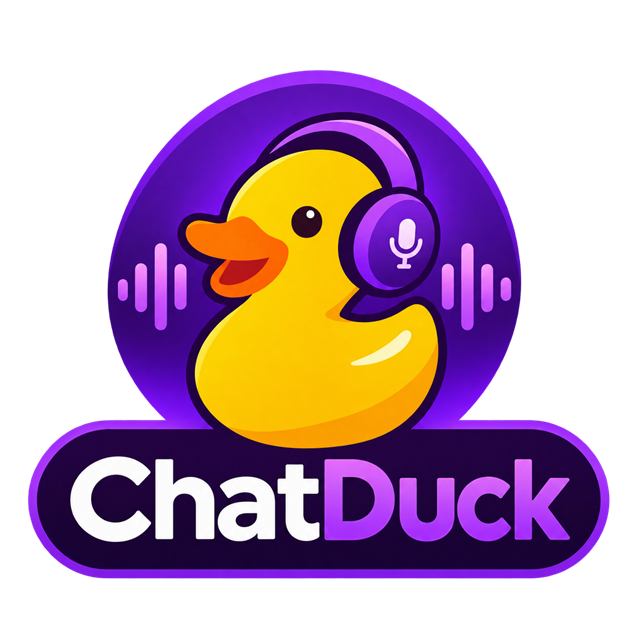
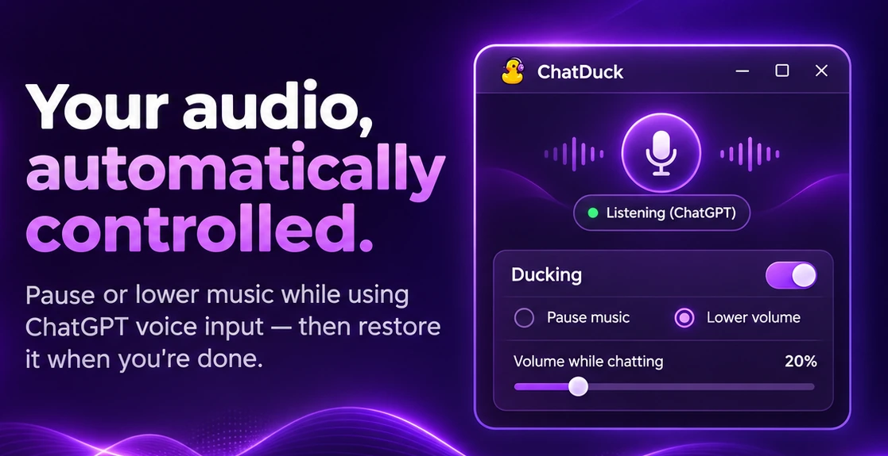
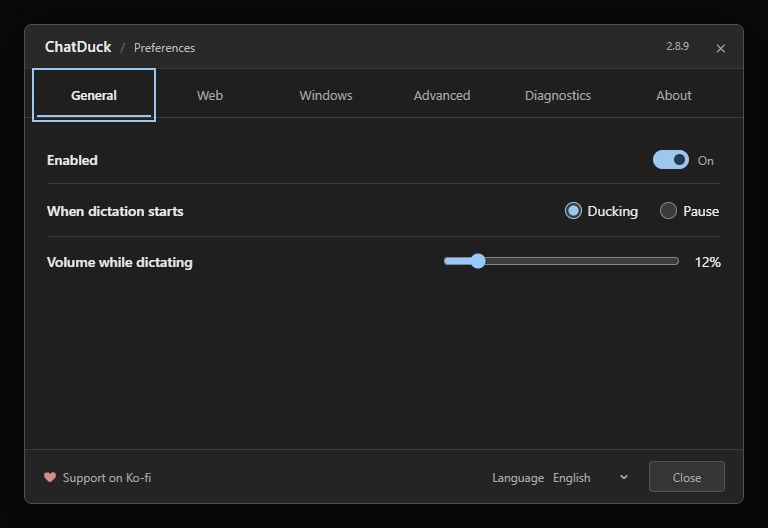
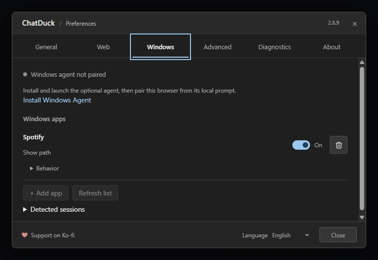

  
  <h1>ChatDuck</h1>
  
<strong>Keep your audio in balance while you dictate to ChatGPT.</strong>

  
<a href="https://github.com/fevegit/chatduck/releases/latest">v2.8.9</a> · <a href="LICENSE">MIT License</a> · Browser + optional Windows Agent

  
<a href="README.es.md">Español</a>

Promotional illustration; the app panel in the artwork is not a product screenshot.

  
  

  

## What it does

ChatDuck coordinates compatible media playback with ChatGPT voice dictation. **Browser Mode** works on its own; the optional **Windows Agent** adds controls for selected desktop media apps.

## In the app

Fresh dark-theme captures of the actual 2.8.9 userscript UI, rendered in isolated Chromium by executing the exact release bundle. The Windows page uses a demo app entry; the preview has no paired agent and contains no personal data. The promotional artwork above is separate from these product screenshots.

## Browser Mode

The userscript controls compatible HTML5 audio and video in the browser. Choose **Pause** or **Ducking**, set the ducked volume, and add per-site rules or exclusions. Each frame manages its own document. ChatGPT and communication sites are excluded from media control by default.

It does not intercept Web Audio or patch page APIs. Closed shadow roots, custom players without controllable HTML media, and Web Audio-only playback are outside its control. The optional tab-mute fallback mutes an entire tab rather than an individual media element.

## Optional Windows Agent

The agent adds per-app controls for compatible Windows media sessions, including desktop players such as Spotify and Plex. Select detected apps or add an executable, then choose Pause or Ducking and set its volume. Pause depends on media-key support; Ducking depends on an accessible audio session. The agent does not control arbitrary application functions or Windows master volume.

It runs as the signed-in user and communicates with the userscript over loopback after pairing. The x64 MSI requires Windows 10 version 1809 or later and the **.NET 10 Desktop Runtime (x64)**. The MSI is **unsigned**. Installation and update were verified on the maintainer's Windows computer; compatibility has not been tested exhaustively across other computers or hardware.

## Install and configure

1. Install [Tampermonkey](https://www.tampermonkey.net/) in a supported desktop browser.
2. Use **Install userscript** above and confirm the prompt in Tampermonkey.
3. Open **ChatGPT Audio Ducking → Open ChatDuck settings** from Tampermonkey.
4. Install the optional Windows Agent only if you need desktop-app controls; launch it and follow its pairing instructions.

The userscript keeps its original name and namespace so Tampermonkey can update existing installations in place. Preferences stay in Tampermonkey; agent pairing and settings are stored for the current Windows user.

## Privacy, security, and removal

ChatDuck has no analytics, telemetry, account, or paid features. The userscript does not request microphone or camera access. The optional agent listens on `127.0.0.1`, authenticates commands with HMAC after pairing, and does not capture microphone audio. Read [Privacy](docs/PRIVACY.md), [Permissions](docs/PERMISSIONS.md), and [Security](docs/SECURITY.md).

Remove **ChatGPT Audio Ducking** from the Tampermonkey dashboard. Uninstall **ChatDuck Windows Agent** separately from Windows Settings → Apps. See the [uninstall guide](docs/UNINSTALL.md).

## Build from source

Source code, regression tests, and reproducible build steps are in this repository. See [Development](docs/DEVELOPMENT.md). Release downloads include a SHA-256 manifest. ChatDuck is free and open source under the [MIT License](LICENSE); Ko-fi donations are voluntary and do not unlock features.
