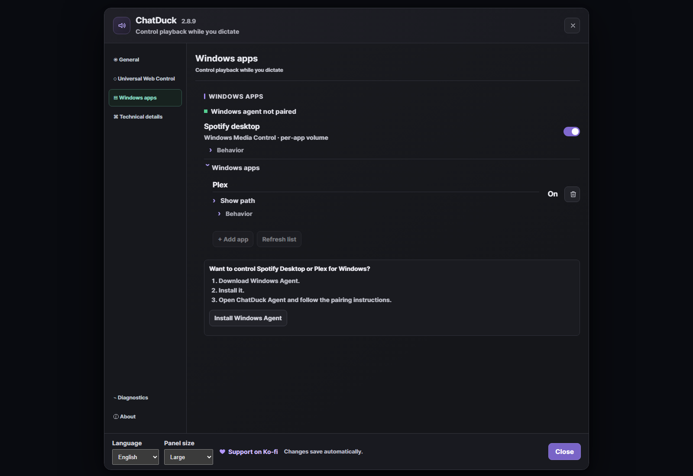

  
  <h1>ChatDuck</h1>
  
<strong>Keep your audio in balance while you dictate to ChatGPT.</strong>

  

    
    
    
    
  

  
<a href="README.es.md">Leer en español</a> · <a href="https://ko-fi.com/fevee">Support on Ko-fi</a>

---

## Install

  
  &nbsp;
  

1. Install [Tampermonkey](https://www.tampermonkey.net/) in a supported desktop browser.
2. Open **Install userscript** above and confirm in Tampermonkey.
3. Open ChatDuck from Tampermonkey's menu to configure playback behavior.

The legacy userscript name and namespace are intentionally preserved. Existing Tampermonkey installations should update in place rather than create a second script.

## What it does

ChatDuck coordinates compatible media playback with ChatGPT voice dictation. Browser Mode is the complete, agent-free option. The optional Windows Agent adds controls for selected desktop media apps.

Captured from the isolated local preview using the 2.8.9 Native settings code; it is not a live user session.

### Browser Mode

The userscript controls supported HTML5 audio and video in the browser, including sites you add or leave enabled for universal control. Choose **Pause** or **Ducking**, set the ducked volume, and configure site-specific overrides or exclusions in the Native settings panel. Each frame manages its own document. ChatGPT and communication sites are excluded from media control by default.

It does not intercept Web Audio or patch page APIs. Closed shadow roots, players that do not expose controllable HTML media, and Web Audio-only playback are outside its control. The optional Tampermonkey tab-mute fallback mutes an entire tab and is separate from per-media ducking.

### Optional Windows Agent

The preview uses demo data and shows an unpaired Windows Agent.

The agent adds per-app controls for compatible Windows media sessions, including desktop players such as Spotify and Plex. Select detected apps or add an executable, then choose Pause or Ducking and configure its volume. Pause depends on media-key support; Ducking depends on an accessible audio session. The agent does not control arbitrary application functions or the Windows master volume.

The agent is optional and runs as the signed-in user. It communicates with the userscript over loopback and pairs with a per-install secret. Install the x64 MSI only if you want desktop-app control. It requires Windows 10 version 1809 or later and the **.NET 10 Desktop Runtime (x64)**. The MSI is currently **unsigned**. Installation and update were verified on the maintainer's Windows computer; this is not exhaustive testing across other computers or hardware.

## Compatibility and requirements

- A desktop browser supported by Tampermonkey (for example, Chrome, Edge, or Firefox).
- ChatGPT voice input for dictation-triggered playback control.
- Optional: Windows 10 version 1809+ x64 and .NET 10 Desktop Runtime x64 for the Windows Agent.
- A compatible player/media session for Windows desktop controls.

The userscript does not request microphone or camera access. ChatGPT itself handles voice input.

## Configure

Open **Tampermonkey → ChatGPT Audio Ducking → Open ChatDuck settings**. Choose the global mode and volume, then adjust site rules, exclusions, browser behavior, and (when paired) selected Windows apps. Preferences are stored locally by Tampermonkey; the agent's pairing and settings are stored for the current Windows user.

## Privacy and security

ChatDuck is local-first: no analytics, telemetry, account, or paid features. The userscript controls media in the current page through its isolated userscript context. The optional agent listens only on `127.0.0.1`, uses HMAC-authenticated commands after pairing, and does not capture microphone audio. See [Privacy](docs/PRIVACY.md), [Permissions](docs/PERMISSIONS.md), and [Security](docs/SECURITY.md).

## Uninstall

- **Browser:** remove **ChatGPT Audio Ducking** from the Tampermonkey dashboard.
- **Windows Agent:** remove **ChatDuck Windows Agent** from Windows Settings → Apps.

See the [full uninstall guide](docs/UNINSTALL.md).

## Build from source

The source, regression tests, and reproducible build steps are in this repository. See [Development](docs/DEVELOPMENT.md). Release assets include a SHA-256 manifest.

## Support

ChatDuck is free and open source under the [MIT License](LICENSE). Donations are optional and do not unlock features.

